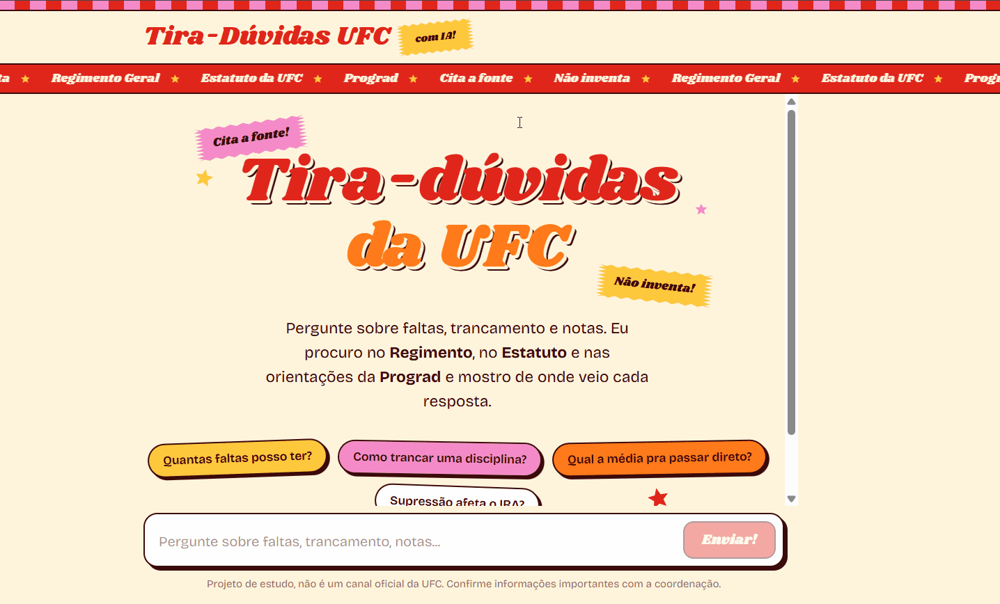
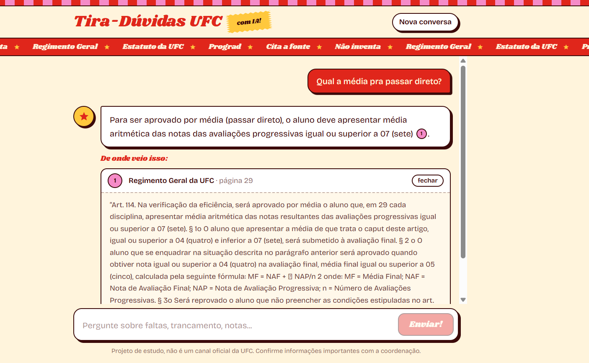
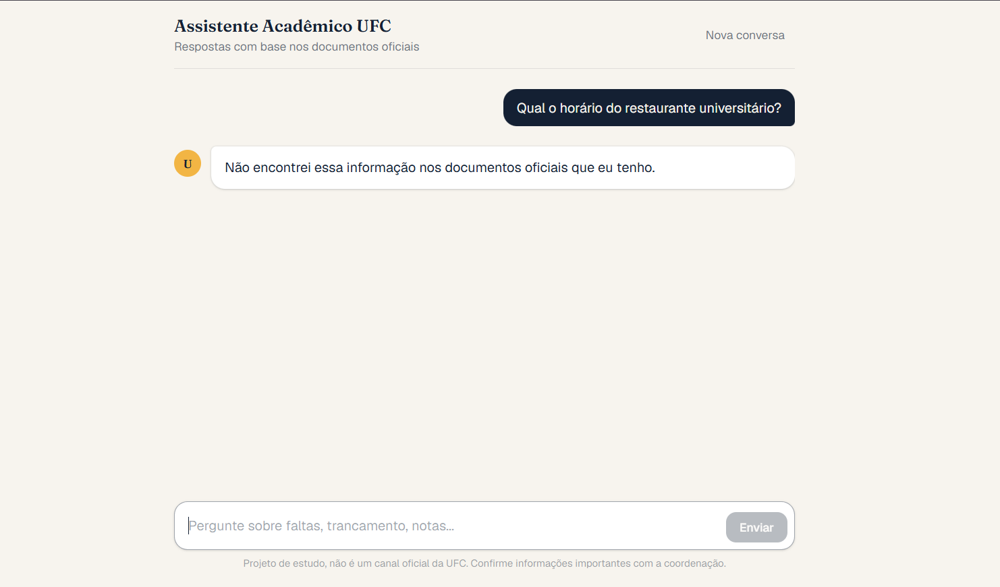
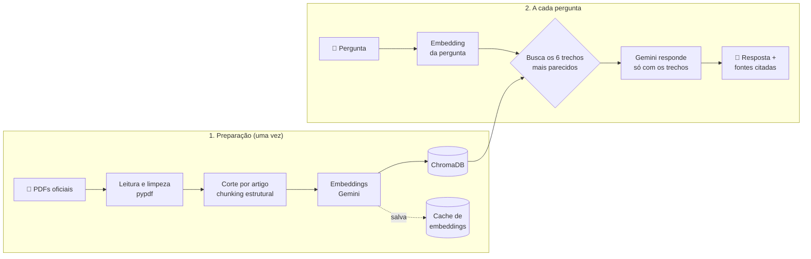

# 🎓 Assistente Acadêmico UFC

Um assistente com IA que responde dúvidas de estudantes da **Universidade Federal do Ceará** sobre as regras da graduação, como faltas, trancamento e notas. Ele busca a resposta **nos documentos oficiais**, mostra **de qual documento e página** ela veio e, quando a informação não está nos documentos, **diz que não sabe em vez de inventar**.

**🔗 Teste agora: [ufc-rag.vercel.app](https://ufc-rag.vercel.app)**

> ⏳ A API está no plano grátis do Render, que "dorme" depois de 15 minutos sem uso. Se a primeira pergunta demorar uns 50 segundos, é o servidor acordando. As próximas respostas são rápidas.



---

## ✨ O que ele faz

- **Responde com base nos documentos oficiais**: Regimento Geral da UFC, Estatuto da UFC e orientações da Prograd sobre supressão e trancamento
- **Cita as fontes** em cada resposta (documento, página e o trecho original, que dá pra abrir e conferir)
- **Não inventa**: se a resposta não está nos documentos, ele avisa
- **Avaliação automática** com 20 perguntas, que mede se a busca, a resposta e a citação estão certas

| Resposta com fontes | Pergunta fora dos documentos |
|---|---|
|  |  |

---

## 🧠 Como funciona

O projeto usa **RAG** (*Retrieval-Augmented Generation*, ou geração com apoio de busca). Em vez de confiar no que o modelo "sabe", ele primeiro **busca** os trechos certos nos documentos e só depois **gera** a resposta com base neles.



1. **Leitura**: os PDFs são lidos página por página, e o texto é limpo (quebras de linha, palavras partidas com hífen)
2. **Corte em pedaços (chunks)**: cada artigo vira um pedaço. Artigos grandes são divididos por frases, e cada continuação leva o nome do artigo (`[Art. 110, continuação] ...`)
3. **Embeddings**: cada pedaço vira uma lista de 768 números que representa o *significado* do texto. Textos com sentido parecido ficam com números parecidos
4. **Busca**: a pergunta também vira embedding, e o ChromaDB encontra os 6 pedaços mais próximos (similaridade de cosseno)
5. **Resposta**: o Gemini recebe os trechos numerados `[1]`, `[2]`... e regras claras: responder **só** com base neles, citar o número do trecho e dizer "não encontrei" quando não houver resposta

---

## 📊 Avaliação

Para não depender de "parece que funciona", criei um conjunto de **20 perguntas** ([`perguntas.json`](backend/avaliacao/perguntas.json)):
- **16 perguntas que estão nos documentos**, cada uma com o documento, o artigo e as palavras que a resposta precisa ter
- **4 perguntas que não estão nos documentos** (horário do RU, Wi-Fi...), em que o certo é dizer que não sabe

Para cada pergunta, o script [`avaliar.py`](backend/app/avaliar.py) confere três coisas:
1. **Busca**: o trecho certo veio entre os 6 encontrados?
2. **Resposta**: tem as informações esperadas (ou recusou, quando devia)?
3. **Citação**: as fontes citadas são do documento e do artigo certos?

### Antes e depois do corte por artigo

A primeira versão cortava os PDFs a cada 1000 caracteres. A avaliação mostrou um problema: as respostas estavam certas, mas muitas vezes **sem a fonte certa**, porque os parágrafos de artigos grandes caíam em pedaços sem o "Art. X" escrito. Troquei pelo **corte por artigo** e medi de novo:

| Métrica | Antes | Depois |
|---|---|---|
| Busca encontrou o trecho certo | 81% | **94%** |
| Citou a fonte certa | 56% | **88%** |
| Resposta correta | 100% | 100% |
| Disse "não sei" quando devia | 100% | 100% |

**A citação correta subiu 32 pontos** com uma única mudança no jeito de cortar os documentos.

---

## 🛠️ Tecnologias

| Parte | Tecnologia |
|---|---|
| Embeddings | Gemini `gemini-embedding-001` (768 dimensões) |
| Modelo de resposta | Gemini `gemini-3.1-flash-lite`, com `gemini-3.8-flash` de reserva |
| Banco vetorial | ChromaDB |
| Back-end | Python + FastAPI |
| Front-end | Next.js + React + TypeScript + Tailwind CSS |
| Containers | Docker + Docker Compose |
| Hospedagem | Render (API) e Vercel (site), ambos no plano grátis |

---

## 🧩 Decisões técnicas

- **Chunking estrutural (por artigo).** Documentos jurídicos têm estrutura: artigos, parágrafos e incisos. Respeitar essa estrutura fez a citação correta subir de 56% para 88% (ver avaliação). Só conta como início de artigo quando o "Art." abre uma frase, para não cortar em citações como "conforme o Art. 54 do Estatuto".
- **Cache de embeddings.** O plano grátis do Gemini permite 1000 embeddings por dia, e descobri isso estourando a cota 😅. Agora cada embedding fica salvo em `backend/cache/embeddings.json`, e só os pedaços novos ou alterados vão para a API. Com isso, o Docker e o servidor online montam o banco em segundos e **sem gastar nenhuma chamada**.
- **Troca segura do banco.** O banco antigo só é substituído quando todos os embeddings novos estão prontos. Se a cota acabar no meio, o assistente continua funcionando com a versão anterior.
- **Prompt que proíbe inventar.** O modelo só pode usar os trechos encontrados, precisa citar `[n]` em cada informação e tem uma frase fixa para quando não sabe. A temperatura é baixa (0.1), para respostas mais fiéis.
- **Só mostra as fontes citadas.** O código lê quais `[n]` aparecem na resposta e mostra só esses trechos, em vez de despejar os 6 encontrados.
- **Resistência a falhas.** O plano grátis às vezes responde com "servidor lotado" (503) ou "demorou demais" (504). O back-end tenta de novo com espera crescente e, se não der, troca para um **modelo reserva** (*fallback*). O usuário recebe uma mensagem amigável em vez de um erro.
- **Chave sempre fora do código.** A chave do Gemini fica no `.env` (no PC) ou nas variáveis de ambiente do Render (online), e nunca vai para o repositório.

---

## 🚀 Como rodar

Você vai precisar de uma **chave grátis do Gemini**: [aistudio.google.com/apikey](https://aistudio.google.com/apikey).

### Opção 1: com Docker (mais fácil)

```bash
git clone https://github.com/alanasena/ufc-rag.git
cd ufc-rag
cp backend/.env.example backend/.env   # e coloque sua chave do Gemini dentro dele
docker compose up --build
```

Abra **http://localhost:3000**. A documentação da API fica em **http://localhost:8000/docs**.

### Opção 2: sem Docker

**Back-end** (Python 3.12):
```bash
cd backend
python -m venv .venv
source .venv/bin/activate        # no Windows: .\.venv\Scripts\Activate.ps1
pip install -r requirements.txt
cp .env.example .env              # e coloque sua chave do Gemini
python -m app.indexar             # monta o banco vetorial (usa o cache)
uvicorn app.main:app --reload
```

**Front-end** (Node 20+), em outro terminal:
```bash
cd frontend
npm install
cp .env.example .env.local
npm run dev
```

### Rodar a avaliação

```bash
cd backend
python -m app.avaliar
```
O resultado sai no terminal e em `backend/avaliacao/RESULTADOS.md`.

### Adicionar novos documentos

Coloque o PDF em `backend/docs/` e rode `python -m app.indexar`. Só os pedaços novos vão gerar embeddings.

---

## 📁 Estrutura

```
ufc-rag/
├── backend/
│   ├── app/
│   │   ├── documentos.py   # leitura dos PDFs e corte por artigo
│   │   ├── embeddings.py   # conversa com o Gemini (embeddings)
│   │   ├── indexar.py      # monta o banco vetorial, com cache
│   │   ├── busca.py        # busca os trechos mais parecidos
│   │   ├── resposta.py     # prompt, resposta e fontes citadas
│   │   ├── main.py         # API (FastAPI)
│   │   ├── avaliar.py      # avaliação automática
│   │   └── config.py       # configurações
│   ├── avaliacao/          # perguntas e resultados da avaliação
│   ├── cache/              # cache de embeddings
│   ├── docs/               # PDFs oficiais
│   └── Dockerfile
├── frontend/
│   ├── app/                # páginas (Next.js)
│   ├── components/         # Chat e Mensagem
│   ├── lib/api.ts          # chamada à API
│   └── Dockerfile
└── docker-compose.yml
```

---

## ⚠️ Limitações conhecidas

- **Só sabe o que está nos 3 documentos.** Calendário acadêmico, editais e regras específicas de cada curso ainda não estão incluídos.
- **Documentos podem estar desatualizados.** O Regimento usado é a versão de 2019. Sempre confirme informações importantes com a coordenação.
- **Uma pergunta da avaliação ainda falha na citação** (representantes estudantis no Conselho Universitário). A resposta sai certa, mas o trecho encontrado não traz o número do artigo.
- **O servidor grátis dorme** depois de 15 minutos sem uso, e a primeira resposta depois disso demora.
- **A avaliação compara por palavras-chave**, o que é simples e transparente, mas não entende sinônimos.

## 🔭 Próximos passos

- Busca híbrida (por significado + por palavra-chave) para melhorar a busca em perguntas com termos exatos
- Avaliação com um modelo como "juiz" (*LLM-as-a-judge*) para medir a qualidade das respostas além das palavras-chave
- Incluir o calendário acadêmico e o projeto pedagógico dos cursos do Campus Russas
- Histórico da conversa, para perguntas de continuação ("e se eu for bolsista?")

---

## 👩‍💻 Autora

Feito por **Alana Oliveira de Sena**, estudante de Engenharia de Software na UFC, Campus Russas.

[GitHub](https://github.com/alanasena) · [LinkedIn](https://www.linkedin.com/in/SEU-LINKEDIN)

> Projeto de estudo, não é um canal oficial da UFC.
